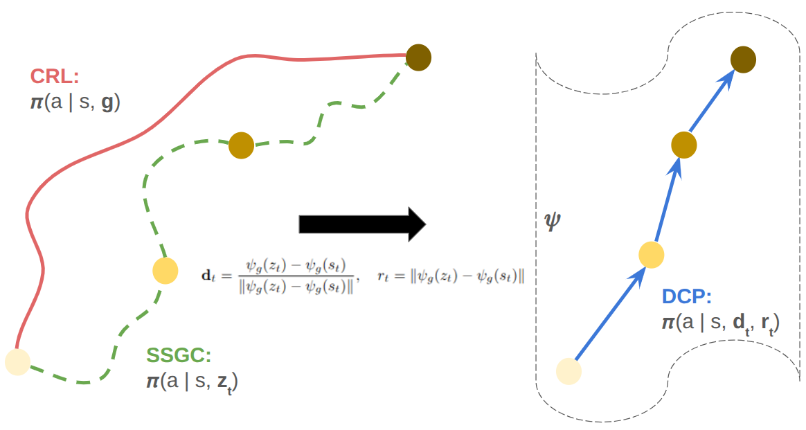
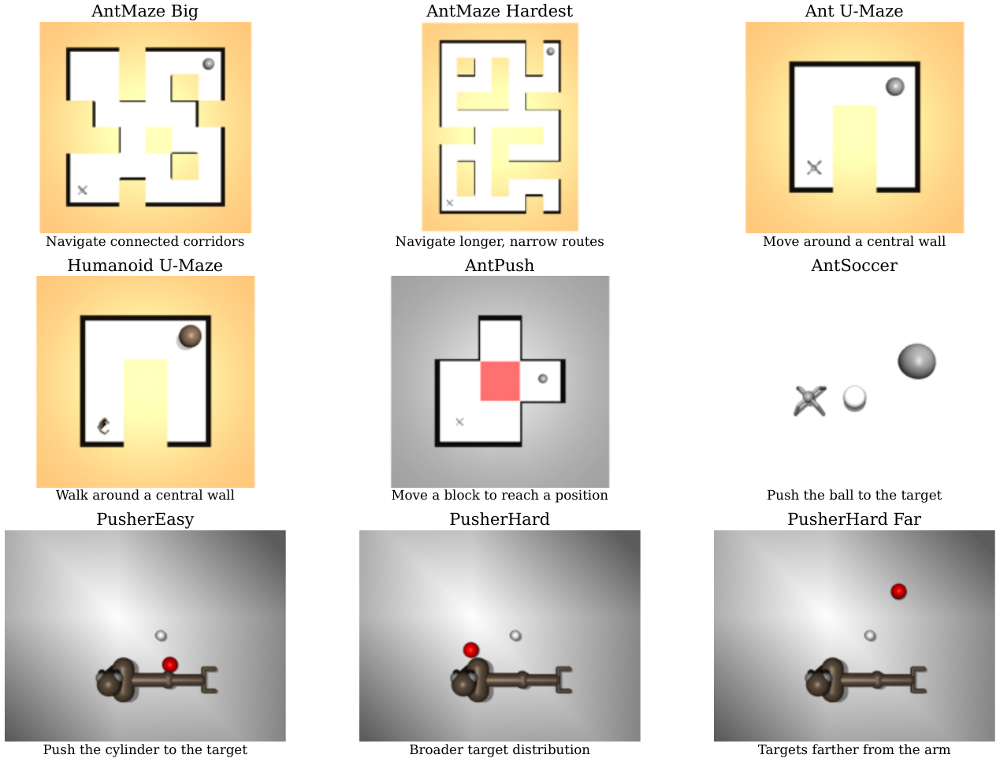
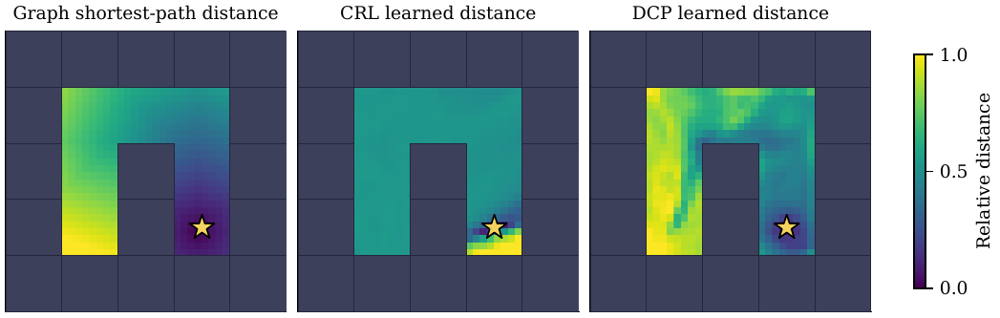

# Direction-Conditioned Policies for Online Goal-Conditioned Reinforcement Learning

[](https://arxiv.org/abs/2610.05087)

**S K Swaminathan, Damiya Gondha, Theyanesh Eswaramoorthy Rajahkrishnan, Aritra Hazra**<br>
Indian Institute of Technology Kharagpur

Contrastive RL (CRL) learns a critic whose representation encodes which goals are reachable from where, but its policy still reads goals as raw coordinates. **Direction-Conditioned Policies (DCP)** give the actor that geometry directly: the actor is conditioned on the direction and distance to its target in the critic's own goal-representation space. DCP keeps the CRL objective, the network depth, and the actor loss, and needs no waypoint selection or planning at deployment.

<p align="center">
  
</p>

## Method

With the critic's goal encoder $\psi$ and achieved-goal map $q$, the actor is $\pi(a \mid s, d, r)$ with

$$d = \frac{\psi(y) - \psi(q(s))}{\lVert \psi(y) - \psi(q(s)) \rVert}, \qquad r = \lVert \psi(y) - \psi(q(s)) \rVert .$$

The same input is used with a different target $y$ at each stage:

| Stage | Target $y$ |
| --- | --- |
| Collection | A visited waypoint, chosen every 25 steps from a pool of visited states by $\psi(z)^\top \psi(g)$ |
| Actor updates | A hindsight future state from the same trajectory |
| Deployment | The final goal $g$ |

**Direct-DCP** keeps the same actor input but collects toward the final goal. The direction input gives most of the gains over raw goals, and the waypoints make learning reliable on tasks where the goal is rarely reached early in training.

## Results

Across nine JaxGCRL navigation and manipulation tasks (five seeds each), DCP reaches higher final success than CRL on seven tasks and spends more time near the goal on seven. Every DCP seed learns on every task.

<p align="center">
  
</p>

Final success (%) / time near goal (steps out of 1,000), mean over five seeds:

| Task | CRL | SSGC | DCP | Direct-DCP |
| --- | --- | --- | --- | --- |
| PusherEasy | 4.4 / 26 | 34.1 / 181 | 55.4 / **298** | **74.2** / 296 |
| PusherHard | 28.8 / 126 | 27.8 / 171 | 47.7 / **281** | **69.0** / 247 |
| PusherHard Far | 12.5 / 48 | 9.0 / 49 | 47.4 / **261** | **54.1** / 176 |
| AntMaze Big | 18.3 / 89 | 23.3 / 100 | **29.9** / 115 | 28.4 / **117** |
| AntMaze Hardest | 12.2 / 48 | 14.2 / **66** | 16.1 / 63 | **18.4** / 59 |
| Ant U-Maze | 40.8 / 261 | 49.8 / 253 | **55.0** / 238 | 46.2 / **270** |
| Humanoid U-Maze | 0.0 / 0.0 | 0.0 / 0.0 | **8.4** / **3.6** | 0.0 / 0.0 |
| AntPush | 45.6 / 143 | **51.4** / **199** | 42.7 / 182 | 19.5 / 65 |
| AntSoccer | **22.6** / **76** | 14.1 / 48 | 12.9 / 42 | 21.4 / 72 |

A CRL actor widened to DCP's parameter count reaches 4.7% success on PusherEasy, so the gains do not come from the extra input weights. In controlled mazes, DCP's representation tracks shortest-path distance more closely than CRL's, and changing only the supplied direction breaks the trained policy, showing that the actor relies on it.

<p align="center">
  
</p>

## Installation

Requires Linux, Python 3.12, and an NVIDIA GPU with a CUDA 12 driver. Dependencies are pinned in `uv.lock`.

```bash
git clone https://github.com/ApRL-IITKGP/direction-conditioned-policy.git
cd direction-conditioned-policy
uv sync --locked
uv run python -c "import jax; print(jax.devices())"
```

## Training

`run.py` trains one agent: `dcp`, `crl`, or `ssgc`. Direct-DCP is `dcp --use-direct-goal-direction`.

```bash
MUJOCO_GL=egl uv run python run.py dcp \
  --env pusher_easy --seed 1 \
  --total-env-steps 50000000 --num-evals 50 \
  --num-envs 512 --batch-size 256 --episode-length 1000 \
  --unroll-length 62 --discounting 0.99 \
  --min-replay-size 1000 --max-replay-size 10000 \
  --contrastive-loss-fn bwd_infonce --energy-fn norm
```

Checkpoints and per-evaluation metrics are written to `runs/run_<exp_name>_s_<seed>/`. Add `--log-wandb` to log to Weights & Biases, and see `uv run python run.py dcp --help` for all options.

Available environments:

| Benchmark | Controlled studies |
| --- | --- |
| `ant_u_maze`, `ant_big_maze`, `ant_hardest_maze`, `humanoid_u_maze`, `ant_push`, `ant_ball` (AntSoccer), `pusher_easy`, `pusher_hard`, `pusher_hard_far` | `simple_open`, `simple_u_maze`, `simple_two_route_maze`, `simple_bottleneck_maze`, `bot_u_maze`, `push_bot_open` |

## Reproducing the paper

**Benchmark.** Train a method on all nine tasks with the paper's seeds (1, 42, 123, 256, 1234) and budgets, then summarize:

```bash
bash scripts/run_benchmark.sh --method dcp          # also: direct_dcp, crl, ssgc, crl_wide
uv run python scripts/summarize_benchmark.py --methods crl ssgc dcp direct_dcp
```

`--env` and `--seed` restrict the grid, and `--dry-run` prints the commands. `crl_wide` is the parameter-matched CRL actor.

**Controlled studies.** Train the controlled agents, then run the analyses (on GPU, from the repository root):

```bash
bash scripts/controlled/train_point_mass.sh   # CRL, Direct-DCP, SSGC, DCP in the open room and U-maze
bash scripts/controlled/train_bot.sh          # differential-drive U-maze
bash scripts/controlled/train_push_bot.sh     # puck pushing
```

| Analysis | Command |
| --- | --- |
| Collection target vs. actor input (four-way table) | `uv run python -m scripts.controlled.factorial_table` |
| Representation geometry vs. graph shortest paths | `uv run python -m scripts.controlled.geometry` |
| Direction interventions, point mass | `uv run python -m scripts.controlled.point_mass_direction_interventions` |
| Direction interventions, differential drive | `uv run python -m scripts.controlled.bot_direction_interventions` |
| Direction interventions, puck pushing | `uv run python -m scripts.controlled.push_bot_direction_interventions` |
| Matched puck-pushing cases, DCP vs. CRL | `uv run python -m scripts.controlled.push_bot_paired_states` |
| Waypoint-to-goal substitution | `uv run python -m scripts.controlled.waypoint_substitution` |
| Waypoint selection by the scorer | `uv run python -m scripts.controlled.waypoint_selection` |

Each analysis takes `--runs-dir`, `--seeds`, and `--json-out`; see `--help`.

## Repository structure

```
jaxgcrl/
  agents/dcp/     DCP and Direct-DCP
  agents/crl/     Contrastive RL
  agents/ssgc/    CRL with scored raw-coordinate waypoints
  envs/           Benchmark and controlled environments
  utils/          Replay buffer, evaluator, configuration
run.py            Training entry point
scripts/          Benchmark launcher, summaries, and controlled studies
```

## Citation

If you find this work useful, please cite:

```bibtex
@misc{swaminathan2026dcp,
  title         = {Direction-Conditioned Policies for Online Goal-Conditioned Reinforcement Learning},
  author        = {S K Swaminathan and Damiya Gondha and Theyanesh Eswaramoorthy Rajahkrishnan and Aritra Hazra},
  year          = {2026},
  eprint        = {2610.05087},
  archivePrefix = {arXiv},
  primaryClass  = {cs.LG},
  url           = {https://arxiv.org/abs/2610.05087}
}
```

## Acknowledgements

This code builds on [JaxGCRL](https://github.com/MichalBortkiewicz/JaxGCRL) and is released under the same Apache 2.0 license.
